# I2C-Based Game Controller Interface in SoC

**A Verilog HDL / System-on-Chip design that reads a game controller's button state over a two-wire I2C bus and presents it to the SoC through an APB-style register interface.**


> **Achievement:** 3rd Place, **Tech Vision 2026** — National-Level Project Expo, CMR Institute of Technology (CMRIT), Bengaluru.

---

## Table of Contents

1. [Overview](#1-overview)
2. [Problem Statement](#2-problem-statement)
3. [Objectives](#3-objectives)
4. [Proposed System](#4-proposed-system)
5. [System Architecture](#5-system-architecture)
6. [Repository Structure](#6-repository-structure)
7. [I2C Protocol Background](#7-i2c-protocol-background)
8. [AMBA APB Interface](#8-amba-apb-interface)
9. [FSM Implementation](#9-fsm-implementation)
10. [RTL Module Descriptions](#10-rtl-module-descriptions)
11. [Communication Flow](#11-communication-flow)
12. [Simulation Methodology](#12-simulation-methodology)
13. [Verification Results](#13-verification-results)
14. [Waveform Screenshots](#14-waveform-screenshots)
15. [Synthesis Results](#15-synthesis-results)
16. [Design Review — Issues Found and Fixed](#16-design-review--issues-found-and-fixed)
17. [Hardware and Software Requirements](#17-hardware-and-software-requirements)
18. [How to Run](#18-how-to-run)
19. [Advantages](#19-advantages)
20. [Applications](#20-applications)
21. [Future Enhancements](#21-future-enhancements)
22. [Team and Achievement](#22-team-and-achievement)
23. [References and Credits](#23-references-and-credits)

---

## 1. Overview

Modern SoCs connect low-cost peripherals through serial buses. This project implements a complete, self-contained example of that pattern in Verilog HDL:

- an **I2C master** inside the SoC that initiates and controls a single-byte read,
- a **game-controller slave** that recognises its 7-bit address, acknowledges the request, and returns an 8-bit button state,
- an **APB-style control/status interface** (`apb_start` / `apb_done` / `apb_data_out`) through which a host requests a transaction and reads the result,
- a **self-checking testbench** that verifies START/STOP, addressing, ACK/NACK, data integrity and completion.

The design is small enough to read in one sitting, but it exercises real protocol and integration concepts: open-drain bus behaviour, a multi-state controller, serial-to-parallel conversion, address decoding, handshake signalling and RTL verification.

The verified revision of the RTL is in [`rtl/`](rtl/). The original project sources are preserved verbatim in [`docs/original_rtl/`](docs/original_rtl/) for traceability — see [Section 16](#16-design-review--issues-found-and-fixed).

---

## 2. Problem Statement

Embedded systems and SoCs need a simple, low-pin-count way to acquire input from external devices such as game controllers. A parallel interface would consume many package pins and board traces; a custom protocol would not interoperate with existing peripherals.

The problem addressed here is:

> **How can an SoC read an external controller's button state over a standard two-wire I2C bus, with a well-defined register-style handshake, while keeping the RTL modular, synthesizable and verifiable?**

The project demonstrates the complete path from button input, through I2C serialisation and addressing, back into an SoC-visible status register.

---

## 3. Objectives

1. Implement an I2C master in Verilog that generates START and STOP conditions, transmits a 7-bit slave address with the R/W bit, samples ACK/NACK, and receives one data byte.
2. Model a game controller as an I2C slave that decodes its address, acknowledges the request and returns an 8-bit button state.
3. Expose the transaction through an APB-style request/complete interface (`apb_start`, `apb_done`, `apb_slave_addr`, `apb_data_out`).
4. Integrate both blocks in a synthesizable top level (`soc_top`) with a shared open-drain SDA bus.
5. Verify the design with a self-checking simulation covering a valid read, a second data pattern, and an unaddressed (NACK) case.
6. Produce synthesis evidence and professional documentation suitable for RTL/VLSI review.

---

## 4. Proposed System

```
        ┌──────────────────────────── soc_top ────────────────────────────┐
        │                                                                  │
 apb_start ─────────────►┌──────────────────┐                              │
 apb_slave_addr[6:0] ───►│  i2c_master_apb  │── scl ──┐                    │
 clk / reset ───────────►│  (FSM + shift)   │          │                   │
        │                │                  │── sda ──┼──► open-drain bus   │
        │◄── apb_done ───│                  │          │                    │
        │◄── apb_data_out│                  │          │                    │
        │                └──────────────────┘          │                    │
        │                                              ▼                    │
        │                ┌──────────────────────────────┐                   │
 button_state[7:0] ─────►│ i2c_game_controller_slave    │                   │
        │                │ (address decode + ACK + data)│                   │
        │                └──────────────────────────────┘                   │
        │                                                                   │
 button_status[7:0] ◄──────────── apb_data_out                              │
        └───────────────────────────────────────────────────────────────────┘
```

The host presents a 7-bit address and pulses `apb_start`. The master performs a complete I2C read and pulses `apb_done` when the byte has been captured. `apb_data_out` is exported as `button_status[7:0]`.

---

## 5. System Architecture

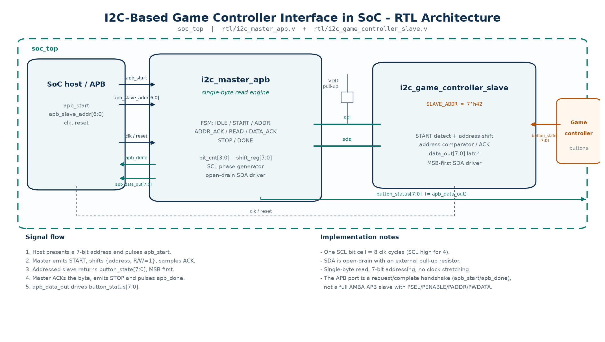

**RTL-level connections (all names are taken directly from the source):**

| From | Signal | To | Purpose |
|---|---|---|---|
| `soc_top` input | `clk` | master, slave | 100 MHz system clock in simulation |
| `soc_top` input | `reset` | master, slave | Active-high asynchronous reset |
| `soc_top` input | `apb_start` | master | Starts one read transaction |
| `soc_top` input | `slave_addr[6:0]` | master → `apb_slave_addr` | Target I2C address (0x42 in the tests) |
| master | `scl` | slave, `soc_top` output | Serial clock, generated from `clk` |
| master ↔ slave | `sda` (inout) | slave, `soc_top` inout | Bidirectional open-drain data |
| master | `apb_done` | `soc_top` internal | One-cycle completion pulse |
| master | `apb_data_out[7:0]` | `button_status[7:0]` | Received button state |
| controller | `controller_buttons[7:0]` | slave → `button_state` | Button pattern to transmit |

**Clock domains.** Everything is synchronous to `clk`. The master generates SCL by dividing the system clock (one SCL bit cell = 8 `clk` cycles), so SCL changes only on `clk` edges. The slave double-registers SCL/SDA and runs entirely on `clk`; there is no gated clock and no second clock domain in the RTL (the original project used SCL as a clock — see Section 16).

---

## 6. Repository Structure

```
I2C-Based-Game-Controller-SoC/
│
├── rtl/
│   ├── i2c_master_apb.v              # I2C master + APB-style handshake
│   ├── i2c_game_controller_slave.v   # addressed controller slave
│   └── soc_top.v                     # top-level integration
│
├── testbench/
│   └── tb_soc_top.v                  # self-checking testbench
│
├── constraints/
│   └── soc_top.xdc                   # clock constraint + SDA/open-drain note
│
├── docs/
│   ├── architecture/                 # architecture + FSM diagrams (PNG)
│   ├── screenshots/                  # simulation, FSM and synthesis images
│   ├── original_rtl/                 # original sources, preserved verbatim
│   ├── references/                   # project paper + original Vivado images
│   └── original_README.md            # original repository README
│
├── sim/
│   ├── dump.vcd                      # waveform database from the run below
│   └── sim_log.txt                   # verbatim Icarus Verilog console log
│
├── synth/
│   ├── synthesis_log.txt             # verbatim Yosys log
│   └── soc_top_generic_netlist.v     # post-techmap generic netlist
│
├── tools/
│   ├── run_sim.ps1 / run_sim.sh      # reproducible simulation scripts
│   ├── make_diagrams.py              # architecture/FSM figures
│   ├── render_waveforms.py           # VCD → waveform figures
│   └── make_reports.py               # log → console/synthesis images
│
└── README.md
```

---

## 7. I2C Protocol Background

I2C (Inter-Integrated Circuit) is a two-wire, multi-drop bus:

- **SCL** — serial clock, driven by the master.
- **SDA** — serial data, bidirectional and **open-drain**. Every device may only pull the line low; an external pull-up restores the high level. This is why two devices can share the wire without electrical contention: a high level simply means "nobody is pulling low".

**Frame used by this project (single-byte read):**

```
START   address[6:0]  R/W=1   ACK   data[7:0]   ACK   STOP
 SDA ↓      A6..A0      1      0     D7..D0      0     SDA ↑
 while SCL high                                       while SCL high
```

| Element | Implementation |
|---|---|
| **START** | SDA is driven low while SCL is high (`START` state). |
| **Address** | 7 address bits, MSB first, followed by `R/W = 1` for a read. |
| **ACK** | The master releases SDA on the ninth clock; the addressed slave pulls it low. The master samples it while SCL is high. |
| **Data** | The slave drives 8 bits MSB first, changing SDA while SCL is low; the master samples while SCL is high. |
| **Receiver ACK** | After the byte the master drives SDA low for the ninth clock (acknowledge). |
| **STOP** | SDA is released (rises) while SCL is high (`STOP` state). |
| **NACK** | If the address does not match, the slave leaves SDA high; the master detects NACK and terminates with STOP. |

**Timing in this design.** One SCL bit cell is 8 `clk` cycles: SCL low for 4, high for 4. With the 100 MHz testbench clock, the SCL period is 80 ns (12.5 MHz). This is a **functional** clock rate chosen for short simulations; it is **not** an I2C-spec-compliant bus rate (Standard mode 100 kHz / Fast mode 400 kHz). For hardware, increase the divider. No clock-stretching, arbitration or repeated-START support is implemented.

---

## 8. AMBA APB Interface

The design uses an **APB-style request/complete handshake**, not a full AMBA APB slave. This distinction is deliberate and important:

| Full AMBA APB signal | Present here? | This design |
|---|---|---|
| `PCLK`, `PRESETn` | equivalent | `clk`, `reset` (active-high) |
| `PSEL`, `PENABLE` | no | replaced by a single `apb_start` pulse |
| `PADDR` | partial | `apb_slave_addr[6:0]` carries the I2C target address, not a register address |
| `PWDATA` | no | read-only interface |
| `PRDATA` | equivalent | `apb_data_out[7:0]` |
| `PREADY` | equivalent | `apb_done` (one-cycle pulse) |

**Behaviour:**

1. The host drives `apb_slave_addr` and pulses `apb_start` for one clock.
2. The master accepts the request in `IDLE` and runs the I2C frame.
3. `apb_data_out` is updated when the byte is complete (during `DATA_ACK`).
4. `apb_done` pulses for one clock in `DONE`, then the master returns to `IDLE`.
5. If the target NACKs, the master still terminates the bus with STOP and pulses `apb_done`; `apb_data_out` is left unchanged.

This keeps the block easy to attach to a real APB peripheral: a thin wrapper can map `PSEL/PENABLE/PWRITE/PADDR` to `apb_start/apb_slave_addr` and map `apb_done/apb_data_out` back to `PREADY/PRDATA`.

---

## 9. FSM Implementation

### 9.1 Master FSM (`i2c_master_apb`)

| State | Encoding | Function | Exit condition |
|---|---|---|---|
| `IDLE` | 0 | SCL/SDA released high, `apb_done=0` | `apb_start` → `START` |
| `START` | 1 | Drive SDA low with SCL high, then SCL low | after setup phases → `ADDR` |
| `ADDR` | 2 | Shift `{address, 1'b1}` MSB first, 8 SCL clocks | `bit_cnt == 0` → `ADDR_ACK` |
| `ADDR_ACK` | 3 | Release SDA, sample ACK on the 9th clock | ACK=0 → `READ`; ACK=1 → `STOP` |
| `READ` | 4 | Release SDA and sample 8 data bits, MSB first | `bit_cnt == 0` → `DATA_ACK` |
| `DATA_ACK` | 5 | Drive SDA low (receiver ACK); publish `apb_data_out` | → `STOP` |
| `STOP` | 6 | SDA low, raise SCL, release SDA → STOP | → `DONE` |
| `DONE` | 7 | Pulse `apb_done` for one clock | → `IDLE` |

Each bit is executed in four phases per half-period structure (`PH_FALL`, `PH_DRIVE`, `PH_LOW2`, `PH_LOW3`, `PH_RISE`, `PH_HIGH2`, `PH_HIGH3`, `PH_SAMPLE`), giving one full SCL period per eight `clk` cycles and guaranteeing that SDA only changes while SCL is low.

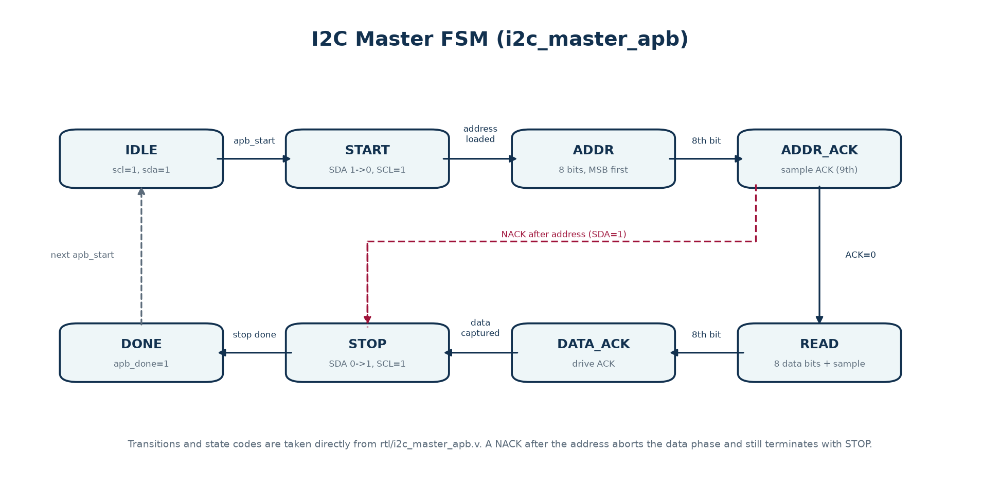

### 9.2 Slave FSM (`i2c_game_controller_slave`)

| State | Encoding | Function | Exit condition |
|---|---|---|---|
| `S_IDLE` | 3 | Bus released, waiting for START | START detected → `S_ADDR` |
| `S_ADDR` | 0 | Shift in 8 bits `{address, R/W}` on SCL rising edges | 8th bit → `S_ACK` |
| `S_ACK` | 1 | Compare with `{SLAVE_ADDR, 1'b1}`; drive ACK or NACK on the falling edge | match → `S_DATA`; else → `S_IDLE` |
| `S_DATA` | 2 | Drive `data_out[bit_cnt]` on SCL falling edges, 8 bits MSB first | last bit → `S_IDLE` |

`SLAVE_ADDR` is a module parameter, default `7'h42`. `data_out` is latched from `button_state` at START, so changes on the controller input during a transfer do not corrupt the byte in flight.

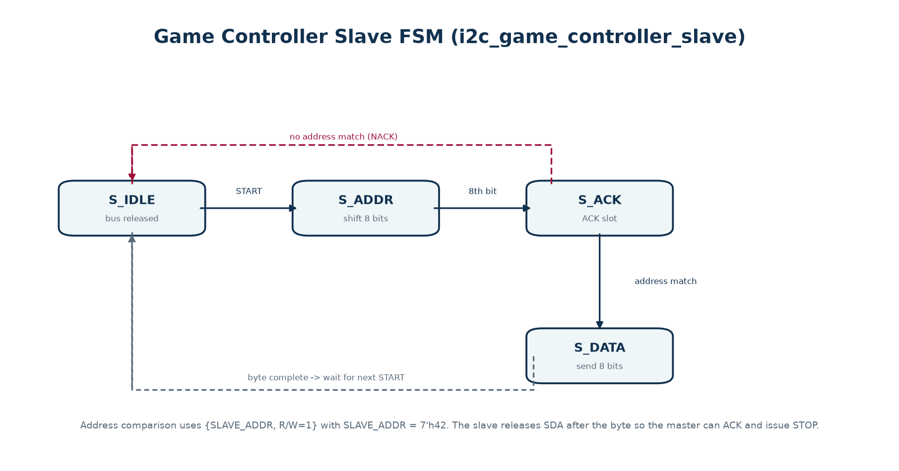

---

## 10. RTL Module Descriptions

### 10.1 `i2c_master_apb.v`

| Port | Dir | Width | Description |
|---|---|---|---|
| `clk` | in | 1 | System clock |
| `reset` | in | 1 | Active-high asynchronous reset |
| `apb_start` | in | 1 | One-cycle transaction request |
| `apb_slave_addr` | in | 7 | I2C target address |
| `apb_done` | out | 1 | One-cycle completion pulse |
| `apb_data_out` | out | 8 | Received byte |
| `scl` | out | 1 | Serial clock |
| `sda` | inout | 1 | Open-drain data (`1'bz` = released) |

Internals: main FSM, 3-bit phase counter, 4-bit `bit_cnt`, 8-bit `shift_reg`, `sda_out` enable, `sda_in` monitor, `ack_received` flag.

### 10.2 `i2c_game_controller_slave.v`

| Port | Dir | Width | Description |
|---|---|---|---|
| `clk` | in | 1 | System clock (all logic is synchronous) |
| `reset` | in | 1 | Active-high asynchronous reset |
| `scl` | in | 1 | Serial clock from the master |
| `sda` | inout | 1 | Open-drain data |
| `button_state` | in | 8 | Controller button pattern |

Parameter `SLAVE_ADDR` (default `7'h42`). Internals: 2-stage SCL/SDA synchronisers plus history for edge/START/STOP detection, address shift register, address comparator, 4-bit bit counter, output latch, SDA drive register.

### 10.3 `soc_top.v`

| Port | Dir | Width | Description |
|---|---|---|---|
| `clk`, `reset` | in | 1 | Clock and reset |
| `apb_start` | in | 1 | Read request |
| `slave_addr` | in | 7 | Target address |
| `controller_buttons` | in | 8 | Button inputs |
| `button_status` | out | 8 | Received button state |
| `scl` | out | 1 | I2C clock |
| `sda` | inout | 1 | I2C data |

It instantiates both blocks, connects the shared `scl`/`sda` bus, and assigns `button_status = data_out`.

---

## 11. Communication Flow

1. **Configuration** — the host sets `slave_addr` (0x42) and `controller_buttons`.
2. **Request** — `apb_start` is pulsed; the master leaves `IDLE`.
3. **START** — SDA falls while SCL is high. The slave detects the condition and resets its address shifter.
4. **Address phase** — the master shifts `{7'h42, 1'b1}` = `1000_0101` (`0x85`) MSB first over 8 SCL clocks.
5. **ACK** — on the 9th clock the slave pulls SDA low; the master samples `0` and records `ack_received`.
6. **Data phase** — the slave drives `button_state[7:0]` MSB first on SCL falling edges; the master samples on the high phase into `shift_reg`.
7. **Receiver ACK** — the master pulls SDA low for the 9th data clock.
8. **Publish** — `apb_data_out` is loaded from `shift_reg`; the master generates STOP (SDA rises while SCL is high).
9. **Complete** — `apb_done` pulses; `button_status` now equals the controller byte.
10. **NACK path** — if the address does not match, the slave leaves SDA high, the master skips the data phase, issues STOP and still pulses `apb_done`; the previous data is retained.

Measured in simulation: a successful read takes **19 SCL edges**; the NACK case takes **10 SCL edges** (address + ACK + the STOP clock).

---

## 12. Simulation Methodology

The testbench `testbench/tb_soc_top.v` is **self-checking**. It does not merely print a value; it compares observed bus activity against expected values and counts failures.

**Stimulus and structure**

- 100 MHz clock (`#5` half-period), active-high reset for 30 ns.
- Three transactions:
  1. `slave_addr = 7'h42`, `controller_buttons = 8'hAC` — nominal read.
  2. `slave_addr = 7'h42`, `controller_buttons = 8'h3C` — proves the byte is not hard-coded.
  3. `slave_addr = 7'h21`, `controller_buttons = 8'hF0` — must be NACKed and must **not** overwrite the output.
- A bus monitor samples SDA 2 ns into each SCL high phase, reconstructs the address, ACK bit and data byte, and independently catches START/STOP conditions.
- `apb_done` is polled with a bounded timeout, so a hang fails instead of silently passing.
- A board-level `pullup (sda);` models the external I2C pull-up resistor.

**Checks performed**

| # | Check | Method |
|---|---|---|
| 1 | Reset values | `scl=1`, SDA released, `apb_done=0` |
| 2 | START condition | SDA falling while SCL high |
| 3 | Address + R/W on the bus | reconstructed byte equals `{addr,1}` |
| 4 | ACK / NACK | 9th-clock SDA level |
| 5 | Data integrity | reconstructed byte equals `controller_buttons` |
| 6 | APB completion | `apb_done` pulses within timeout |
| 7 | Final data output | `button_status` equals the expected byte (or is unchanged on NACK) |
| 8 | STOP condition | SDA rising while SCL high |

`dump.vcd` is generated for waveform inspection.

---

## 13. Verification Results

**Tool:** Icarus Verilog 12.0 (`iverilog -g2012 -Wall` + `vvp`).
**Result:** **ALL CHECKS PASSED** — 3 transactions, 0 failures.

Verbatim console output ([`sim/sim_log.txt`](sim/sim_log.txt)):

```text
VCD info: dumpfile dump.vcd opened for output.
================================================================
 I2C Game Controller SoC - self-checking simulation
================================================================
[26000] Reset OK: SCL=1, SDA=1 (released, pulled high), apb_done=0
[65000] START condition detected (SDA fell while SCL high)
[1605000] STOP condition detected (SDA rose while SCL high)
[1617000] read 0x42 pattern A: transaction complete after 19 SCL edges, ack=0, rx=10101100
PASS [read 0x42 pattern A]: button_status = 10101100 (0xac)
[1635000] START condition detected (SDA fell while SCL high)
[3175000] STOP condition detected (SDA rose while SCL high)
[3187000] read 0x42 pattern B: transaction complete after 19 SCL edges, ack=0, rx=00111100
PASS [read 0x42 pattern B]: button_status = 00111100 (0x3c)
[3205000] START condition detected (SDA fell while SCL high)
[4025000] STOP condition detected (SDA rose while SCL high)
[4037000] read 0x21 (unaddressed): transaction complete after 10 SCL edges, ack=1, rx=00000000
PASS [read 0x21 (unaddressed)]: button_status = 00111100 (0x3c)
----------------------------------------------------------------
RESULT: ALL CHECKS PASSED
================================================================
```

Timestamps are printed with 1 ps precision: `1617000` = **1.617 µs**.

**Observed values**

| Quantity | Observed |
|---|---|
| Address byte on SDA (read) | `1000_0101` = `0x85` (`0x42` + R/W=1) |
| ACK from addressed slave | `0` on the 9th clock |
| Data for pattern A | `1010_1100` = `0xAC` |
| Data for pattern B | `0011_1100` = `0x3C` |
| NACK from unaddressed slave | `1`, data output unchanged (`0x3C`) |
| `apb_start` → `apb_done` | 65 ns → 1617 ns = **1.552 µs** (155 clock cycles at 100 MHz) |
| SCL edges per successful read | **19** |
| SCL period / frequency in this testbench | 80 ns / 12.5 MHz (functional rate, not I2C-spec) |

These are simulation measurements from the supplied testbench, not silicon or board measurements.

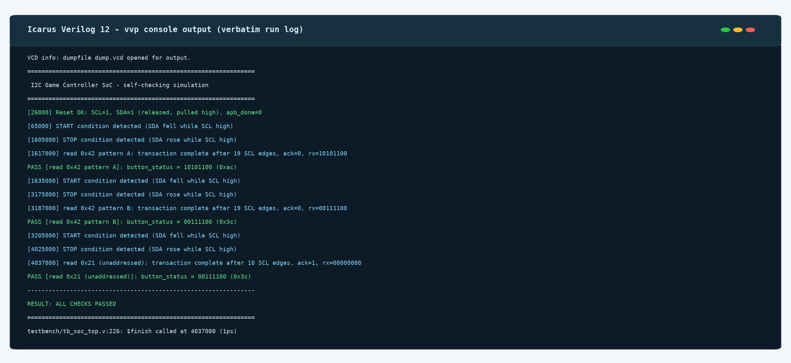

---

## 14. Waveform Screenshots

All waveform images below were produced from the **actual `sim/dump.vcd`** written by the run in Section 13. They are rendered directly from the VCD transition data (script: `tools/render_waveforms.py`), and GTKWave screenshots of the same database are included as application captures.

### 14.1 Full transaction overview

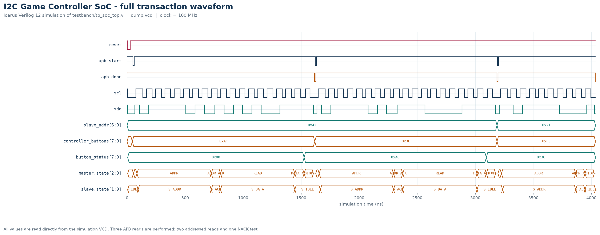

Three reads are visible. `button_status` changes from `0x00` to `0xAC` to `0x3C`; the third (unaddressed) read leaves it unchanged. `apb_done` pulses once per request.

### 14.2 I2C bus detail — START, address, ACK and data

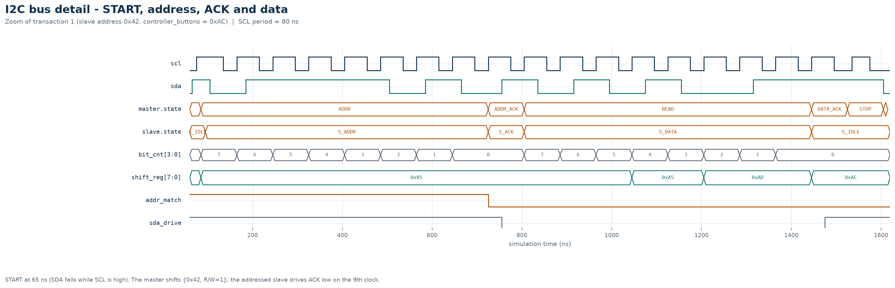

START at 65 ns; the master shifts `0x85`; the slave enters `S_ACK`, pulls SDA low, and the master latches the ACK. `shift_reg` then fills with `0xA5 → 0xAD → 0xAC`.

### 14.3 FSM and datapath

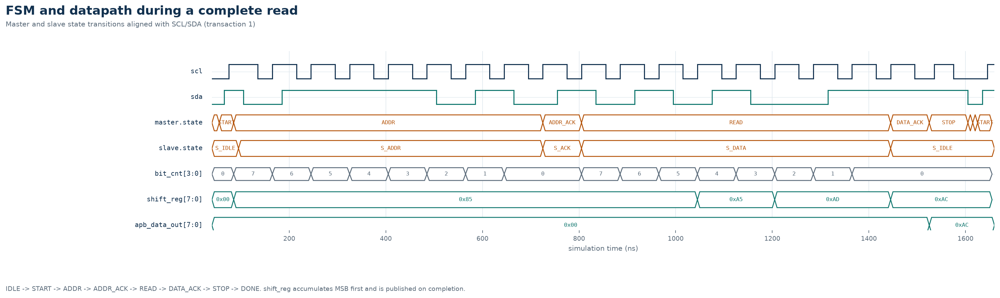

`IDLE → START → ADDR → ADDR_ACK → READ → DATA_ACK → STOP → DONE`, with `bit_cnt` running 7→0 twice and `apb_data_out` publishing `0xAC`.

### 14.4 Final output

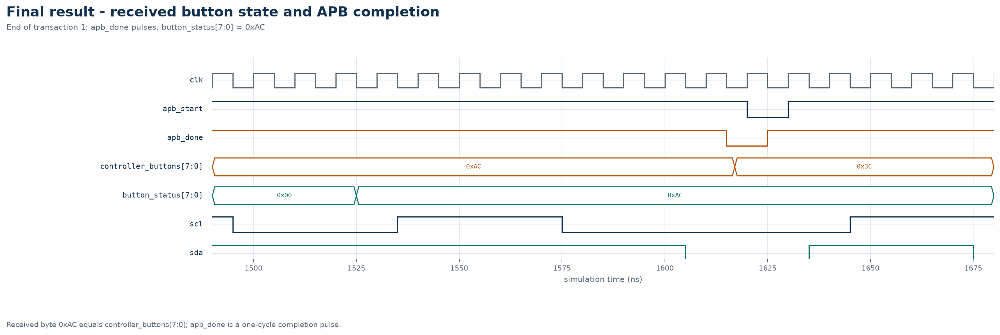

`button_status = 0xAC` equals `controller_buttons[7:0]`, and `apb_done` marks completion.

### 14.5 GTKWave application captures

The same VCD opened in GTKWave:

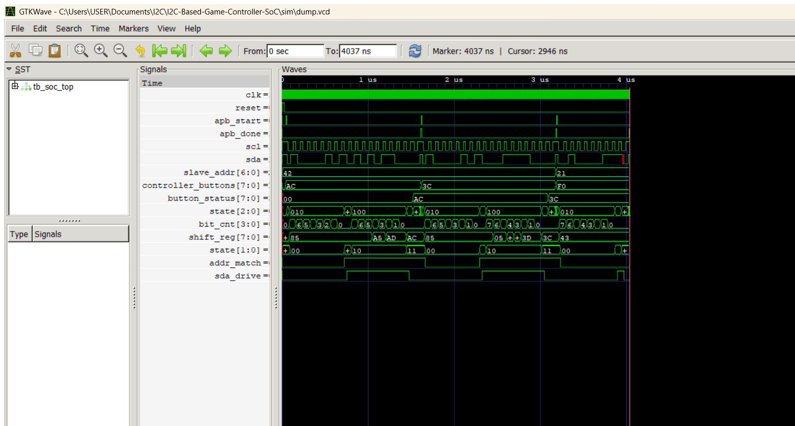

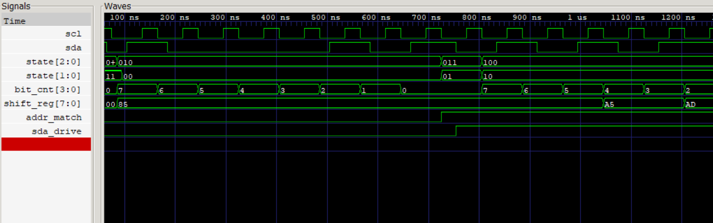

> **Note on Vivado screenshots.** The original submission's Vivado RTL schematic and waveform are preserved unmodified in [`docs/references/`](docs/references/) (`RTL_Schematic_Vivado.jpeg`, `Waveform_Analysis.jpeg`). The revision documented here was executed in an environment **without Vivado installed**, so the new results are Icarus/Yosys/GTKWave outputs and are labelled as such. No Vivado screen is presented as a new capture.

---

## 15. Synthesis Results

The revised RTL was elaborated and mapped with **Yosys 0.71** (`read_verilog` → `hierarchy -check` → `proc` → `opt` → `memory -nomap` → `techmap` → `opt` → `check -assert`). Full log: [`synth/synthesis_log.txt`](synth/synthesis_log.txt).

| Metric | Result |
|---|---|
| Top-level | `soc_top` |
| Submodules | `i2c_master_apb`, `i2c_game_controller_slave` |
| Generic cells after techmap | **687** |
| Flip-flops | **63** |
| Latches | **0** |
| Memories | **0** |
| Unmapped processes | **0** |
| Wires / wire bits | 443 / 981 |
| `check -assert` | **passed** |

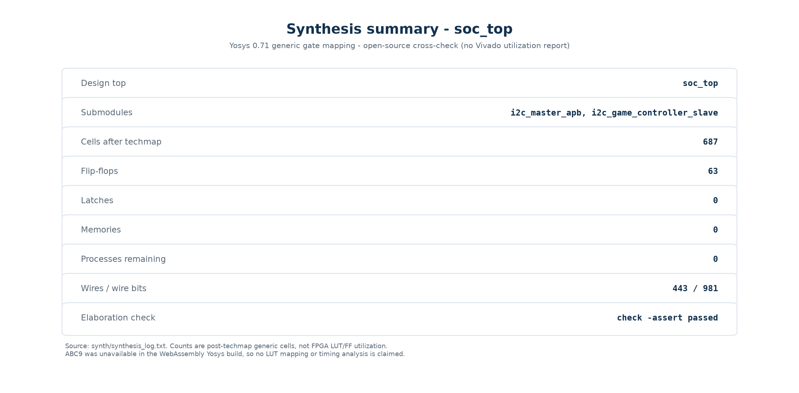

**Scope and limitations.** These are **generic gate-level counts**, not FPGA LUT/FF utilization. ABC9 was unavailable in the WebAssembly Yosys build used here, so no LUT mapping, timing analysis, clock-frequency claim or power estimate is made. The original project was synthesized in Xilinx Vivado and its RTL schematic is retained in `docs/references/RTL_Schematic_Vivado.jpeg`; no new Vivado utilization numbers are claimed.

The design has no latches, no memories, no multi-driven registers, and no combinational loops in the elaborated netlist.

---

## 16. Design Review — Issues Found and Fixed

The original sources (preserved in [`docs/original_rtl/`](docs/original_rtl/)) were first simulated exactly as committed. That baseline run exposed real functional defects, which were then fixed and re-verified. Nothing here is inferred — each item was reproduced from the original code.

### 16.1 Baseline findings

| # | Finding | Evidence |
|---|---|---|
| 1 | The original testbench finished at **140 ns** while the I2C frame was still running, so it printed `Button Status Read: 00000000`. | `baseline/original_tb_output.log` |
| 2 | The original master sampled SDA on the wrong SCL phase and published `apb_data_out` before the last bit was written. The received byte was `0101_0110` (`0x56`) for an input of `0xAC`. | `baseline/original_summary.log`, `baseline/original_trace.log` |
| 3 | The original slave drove SDA during the address phase, contending with the master; SDA resolved to `X` on several address bits. | `baseline/original_trace.log` |
| 4 | No slave address recognition and no ACK/NACK slot existed in the original RTL, although the report describes them. | `docs/original_rtl/*.v` |

The baseline logs are retained in [`baseline/`](baseline/).

### 16.2 Changes in the verified revision

- **Master:** a deterministic 8-phase bit engine (SCL low 4 clk, high 4 clk), address + ACK + data + receiver-ACK + STOP sequencing, correct last-bit capture, and a clean NACK abort path.
- **Slave:** single synchronous state machine (no multiple procedural drivers), START/STOP detection through synchronisers, 7-bit address comparison against parameter `SLAVE_ADDR`, ACK/NACK generation, MSB-first data output, and bus release after the byte.
- **Testbench:** self-checking, waits for `apb_done`, reconstructs the bus traffic, and includes nominal, second-pattern and NACK tests.
- **Integration:** unchanged port lists; `soc_top` wiring is identical to the original.

The original project behavior is not erased: it remains in `docs/original_rtl/` and `baseline/`, and the revision is described here so reviewers can see both the defect and the fix.

---

## 17. Hardware and Software Requirements

**To simulate (as done here)**

- Icarus Verilog 12.0 or later (`iverilog`, `vvp`)
- GTKWave (optional, for waveform viewing)
- Python 3.9+ with `matplotlib` and `pillow` (only to regenerate the documentation figures)
- Any text editor / terminal

**To synthesize and implement**

- Xilinx Vivado (the original project used Vivado; version not recorded in the repository)
- A target FPGA board with two free I/O pins for SCL/SDA and a **pull-up resistor on SDA** (typically 4.7 kΩ to the board's I/O voltage)
- A controller or a second I2C device that responds at the configured 7-bit address

**RTL requirements**

- Verilog-2001 (the sources use plain Verilog; `-g2012` is used for convenience)
- No vendor primitives, no IP cores, no external memories

---

## 18. How to Run

### 18.1 Icarus Verilog (reproduces the results in this README)

```bash
# Linux / macOS / Git Bash
sh tools/run_sim.sh
```

```powershell
# Windows PowerShell
powershell -ExecutionPolicy Bypass -File tools\run_sim.ps1
```

Or manually:

```bash
iverilog -g2012 -Wall -o sim/tb_soc_top.out \
    rtl/soc_top.v rtl/i2c_master_apb.v rtl/i2c_game_controller_slave.v \
    testbench/tb_soc_top.v
cd sim && vvp tb_soc_top.out
```

Expected final line: `RESULT: ALL CHECKS PASSED`.

Open the waveform:

```bash
gtkwave sim/dump.vcd
```

### 18.2 Xilinx Vivado

1. Create an RTL project and add `rtl/soc_top.v`, `rtl/i2c_master_apb.v`, `rtl/i2c_game_controller_slave.v`.
2. Add `testbench/tb_soc_top.v` as a simulation source and set `tb_soc_top` as the simulation top.
3. Add `constraints/soc_top.xdc` and complete the board pin assignments for `clk`, `reset`, `apb_start`, `slave_addr`, `controller_buttons`, `button_status`, `scl` and `sda`.
4. Run **Behavioral Simulation**; the Tcl console should print `RESULT: ALL CHECKS PASSED`.
5. Run **Synthesis** / **Implementation** and inspect the utilization and timing reports for your exact part.

No Vivado project file (`.xpr`) is shipped because the original repository did not contain one; creating the project from the three RTL files and one testbench is deterministic.

---

## 19. Advantages

- **Two-wire interface** — only SCL and SDA leave the SoC; minimal pin and routing cost.
- **Standard protocol** — interoperates with real I2C controllers, sensors and peripherals, not just the included model.
- **Modular RTL** — master, slave and top level are independently readable and reusable.
- **Explicit handshake** — `apb_start` / `apb_done` gives a simple, synthesizable integration point for a host or an APB wrapper.
- **Address decoding and ACK/NACK** — the slave responds only to its own address; the master handles a missing device gracefully.
- **Fully synchronous, single clock** — no gated clocks; 0 latches and 0 unmapped processes after elaboration.
- **Self-checking verification** — regressions fail loudly instead of relying on visual waveform inspection.

---

## 20. Applications

- Game controller and gamepad input in embedded consoles, handhelds and FPGA retro systems.
- GPIO expansion: keypads, button panels, DIP switches and joysticks.
- Sensor hubs and low-speed peripheral aggregation in SoCs.
- Educational RTL labs for I2C, FSMs, open-drain buses and APB integration.
- A reusable I2C master/slave pair for FPGA prototyping and bring-up tests.

---

## 21. Future Enhancements

1. **Multi-byte and burst reads** — extend `bit_cnt`/address auto-increment.
2. **Write transactions** — add the write path and a register map (control, status, interrupt).
3. **Repeated START and combined transfers** — register-address write followed by a read.
4. **Clock stretching and arbitration** — required for a truly multi-master, spec-compliant bus.
5. **Programmable SCL divider** — select 100 kHz / 400 kHz / 1 MHz from a register.
6. **Full AMBA APB slave wrapper** — `PSEL`, `PENABLE`, `PADDR`, `PWDATA`, `PRDATA`, `PREADY`, `PSLVERR`.
7. **Interrupt output** — assert when a new button state is captured.
8. **Assertion-based verification** — SVA properties for START/STOP, ACK and setup/hold.
9. **FPGA validation** — deploy with a real controller and a board-level pull-up; measure SCL timing on hardware.
10. **Multi-device support** — address decoding for several controllers on the same bus.

---

## 22. Team and Achievement

**Project:** I2C-Based Game Controller Interface in System-on-Chip
**Team:** Team Alpha

| Member | Role |
|---|---|
| **Vindhya D** | RTL design, I2C protocol integration |
| **Sanjeitha K S** | RTL verification, simulation and documentation |
| **Yashaswini S** | Architecture, SoC integration and results analysis |

**Achievement:** **3rd Place — Tech Vision 2026**, National-Level Project Expo, CMR Institute of Technology (CMRIT), Bengaluru.

**Project report:** co-authored with **V M Swathika**; academic guides **Dr. Priya Singh** (Department of ECE, Cambridge Institute of Technology) and **Mr. Tharun Reddy** (Design and Verification Engineer, Elevium by Nanochip; external guide). The full paper is in [`docs/references/I2C_Game_Controller_Paper.pdf`](docs/references/I2C_Game_Controller_Paper.pdf).

**Original repository:** <https://github.com/swathika0401/I2C-Based-Game-Controller-Interface-in-SoC>
This maintained copy is published by **Sanjeitha K S** (<https://github.com/sanjeithaks>).

---

## 23. References and Credits

1. NXP Semiconductors, *UM10204 — I2C-bus specification and user manual*, rev. 6.
2. ARM, *AMBA APB Protocol Specification* (IHI 0024).
3. Yashaswini S, Sanjeitha K S, Vindhya D, V M Swathika, Dr. Priya Singh, Mr. Tharun Reddy, *"I2C-Based Game Controller Interface in System-on-Chip Architecture"* — project paper, [`docs/references/`](docs/references/).
4. Original project repository: <https://github.com/swathika0401/I2C-Based-Game-Controller-Interface-in-SoC>
5. Icarus Verilog: <https://steveicarus.github.io/iverilog/>
6. Yosys Open SYnthesis Suite: <https://yosyshq.net/yosys/>
7. GTKWave: <https://gtkwave.sourceforge.net/>

**Attribution.** The original RTL, paper, Vivado schematic and Vivado waveform are the work of the original project team and are retained in `docs/original_rtl/` and `docs/references/`. The verification revision, testbench, diagrams, waveform renders and this README were produced for this maintained copy.

**License.** No open-source license has been selected for this repository. The original artifacts remain the property of their authors; add a license only with the team's agreement.
